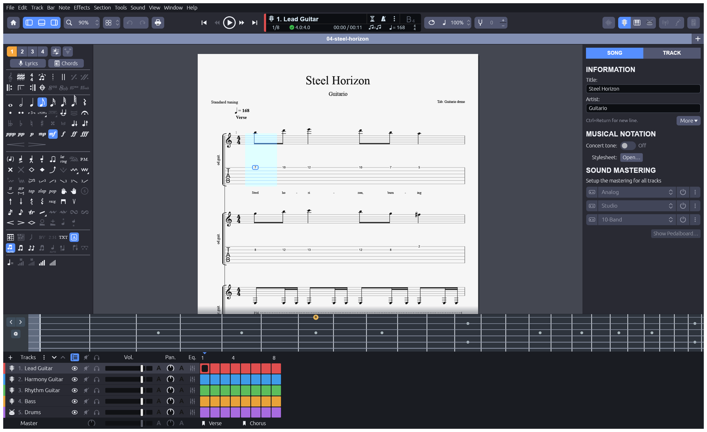
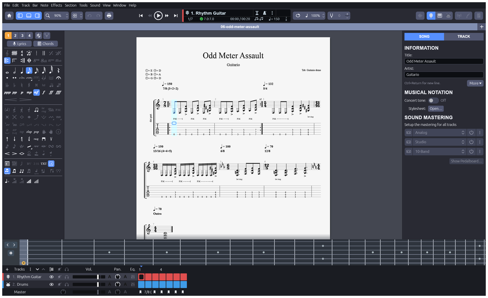
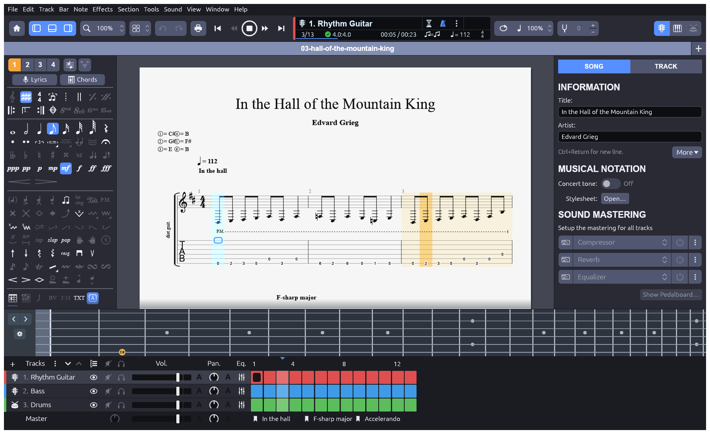
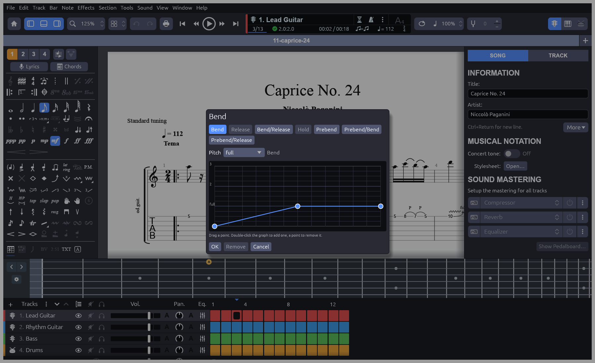
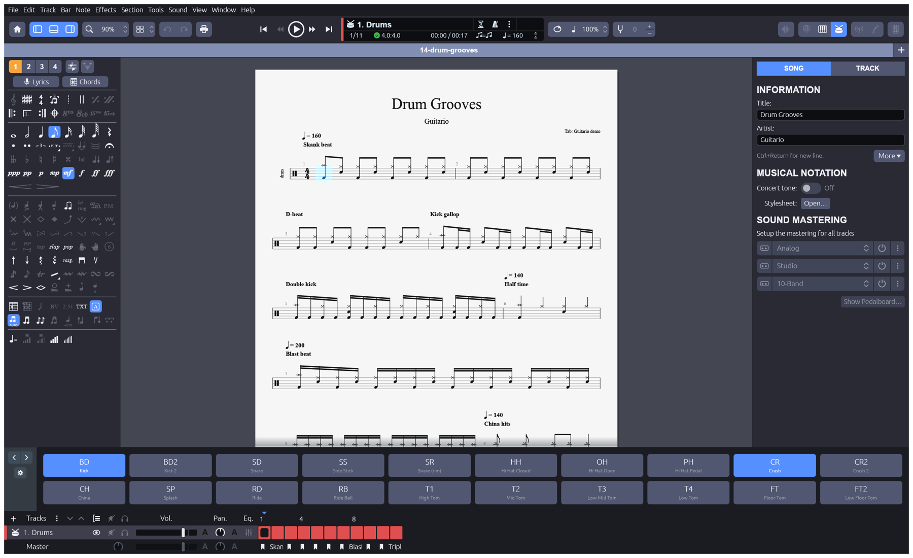
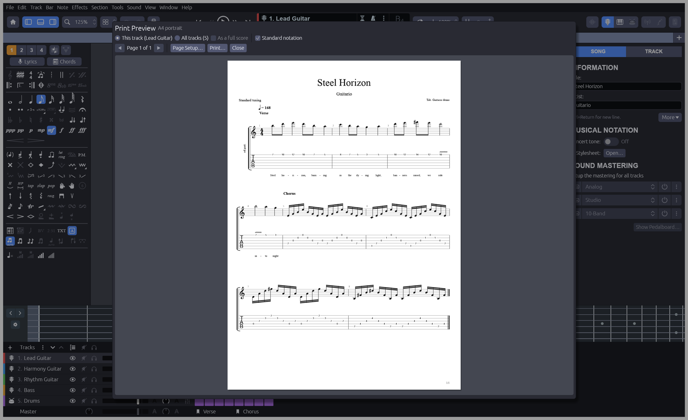

<h1 align="center">Guitario</h1>

<p align="center">
  <b>An open-source tablature and notation editor, in pure Rust.</b><br>
  Guitar Pro's layout, menus and keys; tab and standard notation on real pages; playback you can loop and slow down;<br>
  Guitar Pro files in and out. Native, offline, and yours.<br>
</p>

<p align="center">
  
  
  
  
</p>

<p align="center">
  
  <br>
  <sub><i>Steel Horizon</i>, one of the original metal demos, in the multitrack view: twin harmony leads, rhythm guitar, bass and drums.</sub>
</p>

> [!WARNING]
> Guitario is **alpha**. Writing, arranging with drums, bends and the whammy bar, playing with
> sampled instruments through an amp, practising with the tuner, chord and scale tools, Guitar
> Pro, MIDI and MusicXML exchange, and PDF export and printing work end to end. Beta needs
> several documents open at once, the drum step grid, headers and footers, signed releases that
> open a double-clicked file on every platform, and an agent control channel. See the
> [beta gate](docs/roadmap.md#beta-gate) and [ROADMAP.md](ROADMAP.md).

<p align="center">
  <a href="#what-it-does">What it does</a> ·
  <a href="#demos">Demos</a> ·
  <a href="#built-for-agents">Agents</a> ·
  <a href="#get-started">Get started</a> ·
  <a href="#how-its-built">How it's built</a> ·
  <a href="#where-it-stands">Where it stands</a>
</p>

## What it does

If you know Guitar Pro, you already know Guitario: the same layout, menu bar and shortcuts. Click a
beat, type a fret number, press <kbd>P</kbd> for palm mute or <kbd>H</kbd> for a hammer-on, press
<kbd>Space</kbd> to play. Every screenshot below is the real app rendering one of the original demo
scores offscreen.

<table>
  <tr>
    <td width="50%" valign="top">
      
      <h3>Notation that reads like Guitar Pro</h3>
      Standard notation and tab joined by a bracket, time signatures on both staves, key signatures, beamed rhythms, rests, tuplets, section boxes, tempo marks and repeats. Tab shows P.M. and let-ring lanes, vibrato, slides and hammer-on arcs. Any tuning from 4 to 12 strings, with presets for drop D, D and C standard, drop B and seven-string.
    </td>
    <td width="50%" valign="top">
      
      <h3>Hear it, loop it, slow it down</h3>
      Space plays from the cursor. A plucked-string model plays palm mutes, dead notes, bends, vibrato and legato slides, with sampled drums, bass and guitar available from an SFZ bank. Loop a selection, slow it to 25 % without changing pitch, add a metronome and a count-in, and watch the sounding note on the fretboard. Export WAV, FLAC or MIDI.
    </td>
  </tr>
  <tr>
    <td width="50%" valign="top">
      
      <h3>Bends you draw</h3>
      Seven bend kinds, from a quick quarter-tone to a prebend and release, each drawn on the page as Guitar Pro draws it. Open the Bend window to drag the curve's points, add one with a double-click, and hear it.
    </td>
    <td width="50%" valign="top">
      
      <h3>Drums, with a pad</h3>
      Drum-kit tracks with a percussion staff, a drum pad, Guitar Pro's two-digit entry (<kbd>3</kbd> then <kbd>6</kbd> is a kick), a second voice for the feet, synthesised General MIDI drums with hi-hat choke, and drum tab export.
    </td>
  </tr>
  <tr>
    <td colspan="2" valign="top">
      
      <h3>Pages that print</h3>
      File › Print Preview shows exactly what the PDF has: vector pages with embedded font subsets and selectable text, one section per track, in A4, A5, Letter or Legal, portrait or landscape, with your own margins. Print from the app, or export from the command line.
    </td>
  </tr>
</table>

**Editing.** Fret entry from the keyboard or the fretboard, Guitar Pro's single-key techniques, an
edition palette that shows the current beat, selection with copy, cut, paste and transpose, voices
1 to 4 with multivoice editing, grace notes, trills, tremolo picking, chord diagrams, lyrics, and
undo for every edit. The menu bar is Guitar Pro's, and the items not built yet are greyed out
([menu parity](docs/parity-checklist.md): 161 of 177 live).

**Files.** Opens Guitar Pro 3 to 8 files (`.gp3`, `.gp4`, `.gp5`, `.gpx`, `.gp`), including drum
tracks. Saves `.gt` atomically. Exports `.gp`, `.gp5`, PDF, MIDI, WAV and ASCII tab. Checked on
76 real Guitar Pro files, which all import, and the Guitar Pro 3 to 5 ones come back unchanged
through the `.gp5` writer.

## Demos

[`demos/`](demos/README.md) holds 15 original metal pieces: thrash, doom and death metal, djent on
a seven-string, power-metal twin leads, black-metal tremolo melodies, odd meters, a shred solo, a
fingerstyle study in two voices, and a drum-groove reference. Every band piece has a drum part, and
each score comes with MIDI, ASCII tab and Guitar Pro 5 copies. They are generated from code and
tested on every change.

## Built for agents

Every edit is an engine command with a stable id and JSON params, so the UI, the CLI and the tests
share one entry point:

```sh
cargo run -p guitario-cli -- commands                       # every command, with its params
cargo run -p guitario-cli -- info song.gp                   # summarise a .gt or Guitar Pro file
cargo run -p guitario-cli -- convert song.gp song.pdf       # .gt/.gp/.gp5/.pdf/.mid/.wav/.flac/.txt
cargo run -p guitario-cli -- run - riff.json --save riff.gt # run a script of commands
```

A script is a JSON array of `["command.id", {params}]` steps. A control channel and an MCP server
are on the [roadmap](docs/gaps.md#g10-automation).

## Get started

```sh
cargo run --release -p guitario
cargo run --release -p guitario -- demos/01-thrash-attack.gt
```

Or build the package for your platform with `cargo xtask package` (into `dist/`): an app bundle
and disk image on macOS, a `.deb` and a `.tar.gz` with `install.sh` on Linux, a zip and an
installer on Windows. Releases are not signed yet; see [development](docs/development.md#packages-and-releases).

Then click a beat, type a fret number and press Space. The [user guide](book/src/SUMMARY.md) covers
editing, playback and shortcuts; [development](docs/development.md) covers building and testing.

## How it's built

Pure Rust, with no JavaScript, Tauri, Electron or webview anywhere: the desktop app is native
[egui](https://github.com/emilk/egui) on wgpu, and the engine builds for WebAssembly.

- **Layered crates**, enforced by `cargo xtask layers`: music theory, a pure-data score model,
  playback and synthesis, file formats, audio output, the engine, and the egui shell. A crate may
  depend only on lower layers.
- **Everything is a command.** The engine's command registry is the only way to change a score,
  with undo for each. The UI reads the session and turns input into commands.
- **Never crash.** No `unwrap`, `panic` or `unsafe` in non-test code, hostile input checked at
  every reader, and a fuzz test that sends bad params to every command.
- **Clean-room.** Behaviour and look only, from public format notes and observation. Nothing is
  copied from Guitar Pro or other tab software, and every demo is an original composition.

Details: [architecture](docs/architecture.md), [contributing](docs/contributing.md) and
[AGENTS.md](AGENTS.md).

## Where it stands

| | |
|---|---|
| **Stage** | alpha: the six-workflow [alpha gate](docs/roadmap.md#alpha-gate) passes |
| **Beta gate** | 0 of 8 workflows pass end to end ([the eight](docs/roadmap.md#beta-gate)) |
| **Menus** | 172 of 180 Guitar Pro menu items live |
| **Readiness** | about 65 % of Guitar Pro 8, estimated from weighted dimensions |
| **Languages** | English; the localization framework is a beta item |

The [ROADMAP](ROADMAP.md) has every dimension and what comes next. [Gaps](docs/gaps.md) is the
ranked work list, [scorecard](docs/scorecard.md) is measured from the tree, and
[target-app parity](docs/target-app-parity.md) explains the numbers.

## Security

See [SECURITY.md](SECURITY.md).

---

## License and credits

Guitario is dual-licensed under [MIT](LICENSE-MIT) or [Apache-2.0](LICENSE-APACHE), at your option.
Copyright (c) 2026 the Guitario contributors. Required notices are in [NOTICE](NOTICE).

Bundled assets are listed with their author, source and license in [ATTRIBUTION.md](ATTRIBUTION.md).
Every demo score is an original composition.

<sub>Guitar Pro is a trademark of Arobas Music. Guitario is an independent, open-source project and is not affiliated with, sponsored by or endorsed by Arobas Music; the name is used only to describe the workflows it is compatible with.</sub>
